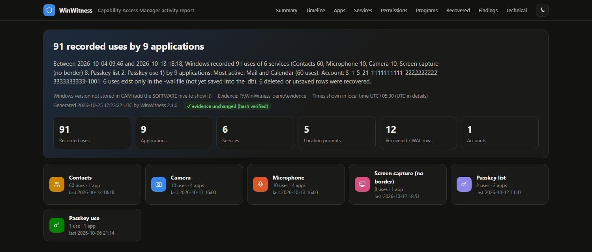
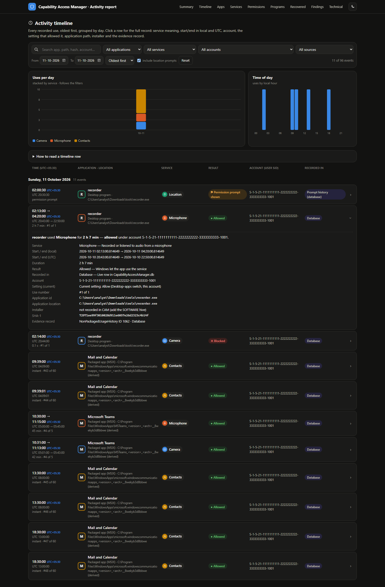
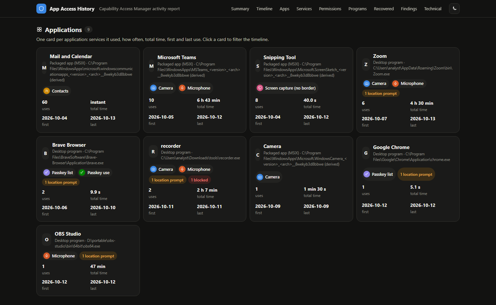
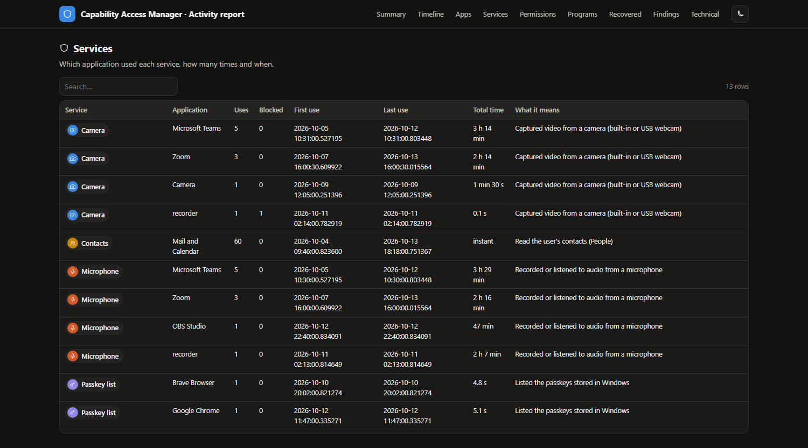
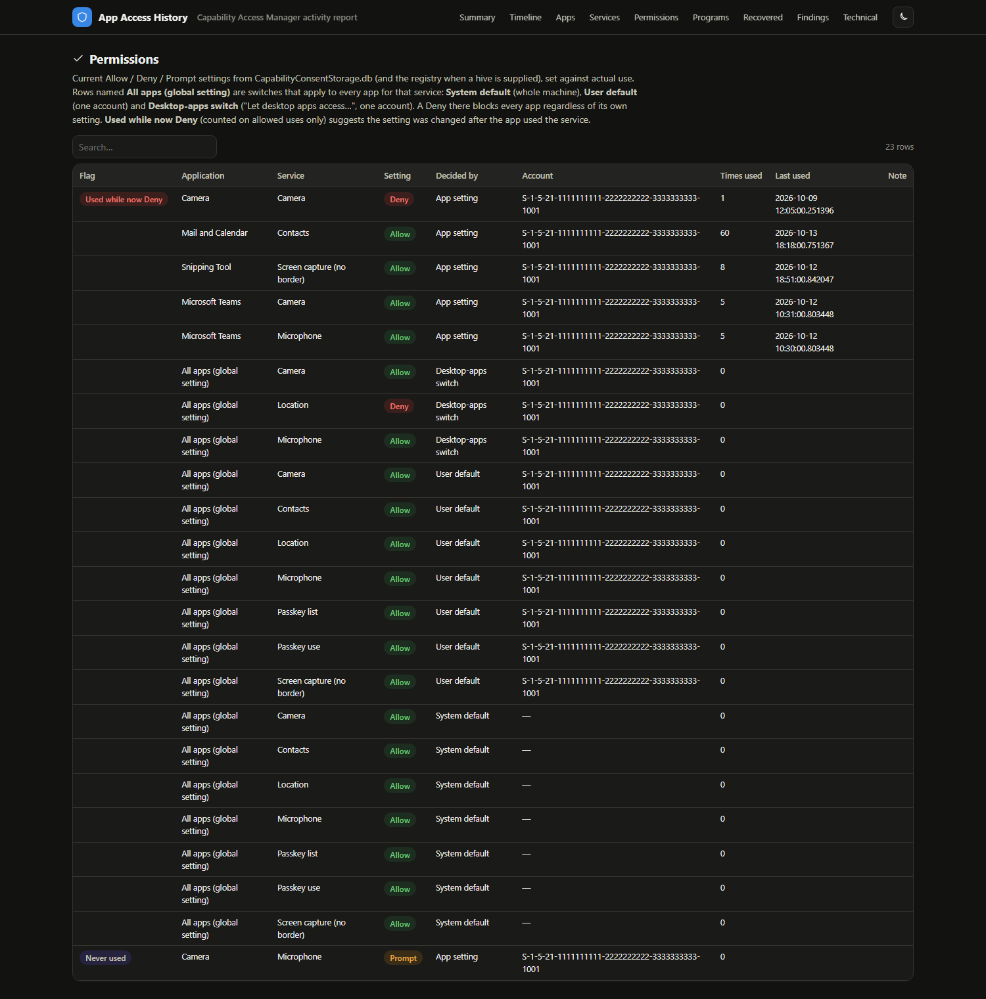
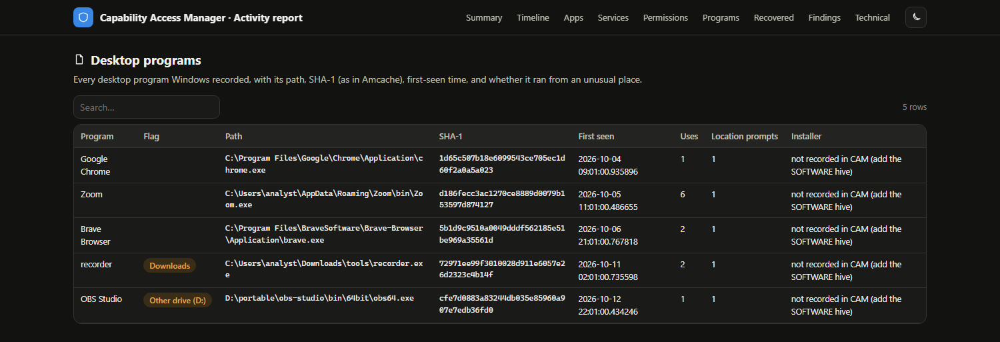
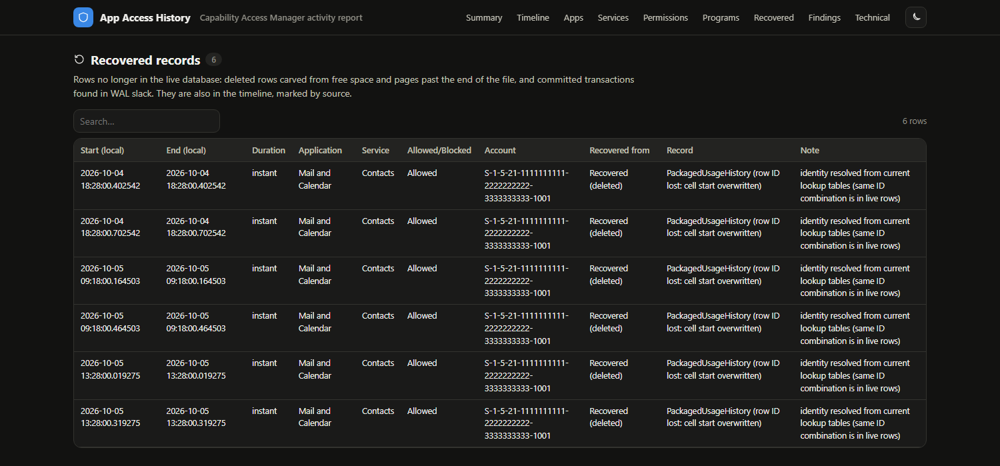
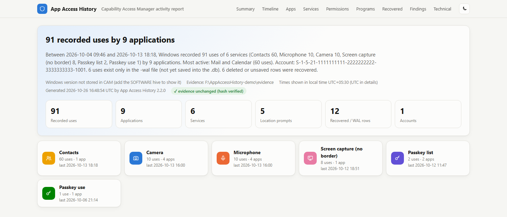

# WinWitness

**Your PC was a witness to every app that used your camera, microphone or location. WinWitness lets it testify.**

WinWitness is a forensic parser for the Windows 11 **Capability Access Manager** databases: `CapabilityAccessManager.db` and `CapabilityConsentStorage.db`.

It reads the databases together with their write-ahead log (WAL), WAL index (SHM), file slack and the NTFS `$I30` index entry. It recovers deleted records and reports everything as an HTML report, CSV, SQLite and JSON. Inputs are never modified.

It is pure Python 3.10+ standard library, with nothing to install, and runs on Windows, Linux and macOS.



---

## Screenshots

All screenshots use **invented demo data** (fake account `S-1-5-21-1111111111-2222222222-3333333333-1001`, user folder `analyst`). The demo is a short story: Teams and Zoom calls, Mail reading contacts, Snipping Tool captures, browser passkeys, and an unknown `recorder.exe` run from Downloads that used the microphone at 2 AM. You can rebuild the same evidence yourself (see [Try it with demo data](#try-it-with-demo-data)).

### Summary
The first screen answers "what happened on this computer".
* **The sentence** gives the period covered, how many uses of which services by how many applications, the most active app and the accounts involved, plus how many rows exist only in the `-wal` file or were recovered after deletion.
* **The tiles** show the key numbers.
* **The service cards** (Camera, Microphone, Contacts…) show, for each service, how many uses, by how many apps, and when it was last used. Click a card to filter the timeline to that service.
* The **evidence unchanged (hash verified)** badge confirms that the input files were hashed before and after the run and did not change.

### Activity timeline


Every use in time order, grouped by day.
* **Filters:** search, application, service, account, source and date range. You can order oldest or newest first.
* **Two charts follow the filters:** uses per day stacked by service, and uses by hour of the day.
* **Each row shows:**

  | Column | Content |
  |---|---|
  | Time | Start → end in local time (time zone shown), the same times in UTC, the duration and the use number (`#3 of 12`) |
  | Application · location | The app and its full path |
  | Service | The service it used |
  | Result | Allowed, Blocked, or Permission prompt shown |
  | Account | The user account (SID) |
  | Recorded in | Where the evidence came from |

* **Click a row** (›) to open the full record: what the service means, local and UTC times, the current permission setting, application id and location, installer, SHA-1 and the exact database record.

In the screenshot, filtered to 11 October, `recorder.exe` from the Downloads folder uses the microphone for 2 h 7 min at night. A minute later it is **Blocked** from the camera.

### Applications


One card per application. Each card shows:
* the app's type (packaged MSIX app or desktop program) and location
* the services it used, with location prompts and blocked attempts
* the number of uses and the total time
* the first and last use

Click a card to filter the timeline to that app.

### Services


Each service, with every application that used it: uses, blocked attempts, first and last use, total time, and a plain description of what the service is.

### Permissions


The current Allow / Deny / Prompt settings from `CapabilityConsentStorage.db`, set against what the apps actually did.

**Decided by** shows the level that holds each setting:
* **App setting** for a single app
* **Desktop-apps switch** ("Let desktop apps access…")
* **User default** for one account
* **System default** for the whole machine

Rows named **All apps (global setting)** are the switches that apply to every app for a service. A Deny at a broader level blocks every app, whatever the app's own setting.

**Flags:**
* **Used while now Deny:** the app was allowed and used the service, but its setting is now Deny. The setting was probably changed afterwards.
* **Never used:** a setting exists but no use was recorded.

### Desktop programs


Every desktop (non-Store) program Windows recorded:
* its full path
* its SHA-1, the same hash Amcache uses, so you can look the file up
* when it was first seen
* its number of uses and location prompts
* its installer (if the SOFTWARE hive is supplied)

Programs that ran from **Temp**, **Downloads** or **another drive** are flagged.

### Recovered records


Rows that are no longer in the live database: deleted rows carved from free space, and transactions found past the end of the `-wal` file.
* **Kept separate:** they are never mixed with live data, and appear in the timeline with their own "Recorded in" label.
* **Lost IDs:** when SQLite overwrote the start of a deleted cell, the row's values are still recovered, and the record says the ID was lost.

### Light theme


The report follows the system theme. Use the moon button to switch between light and dark.

### Desktop window (GUI)
`python winwitness_gui.py` opens a small window with these controls:
* the evidence folder
* the output folder
* the local time offset
* optional registry corroboration
* an optional Amcache CSV
* optional binary hashing

**Run analysis** shows the live log. **Open report** opens the HTML report above.

### Try it with demo data
```bash
python docs/demo/build_demo_evidence.py demo_evidence
python winwitness_cli.py demo_evidence -o demo_report --tz +05:30
```
Open `demo_report/CAM_report.html`. The demo contains live rows, rows only in the `-wal` file, deleted rows to recover, a blocked attempt, location prompts and programs run from unusual places.

---

## 1. The artifact

### What it records
Windows gates access to privacy-sensitive features such as camera, microphone, location, contacts and screen capture through the Capability Access Manager service. Since Windows 11 it keeps two SQLite databases:

| File | Default location | Contents |
|---|---|---|
| `CapabilityAccessManager.db` | `C:\ProgramData\Microsoft\Windows\CapabilityAccessManager\` | **Usage history**: which app used which capability, start and stop time, executable path and hash, user SID |
| `CapabilityConsentStorage.db` | same folder | **Consent decisions**: Allow / Deny / Prompt per capability, per user and per app, plus per-device and per-site consents |
| `*.db-wal`, `*.db-shm` | same folder | SQLite write-ahead log and its index. Committed changes that are not yet in the main file |

The folder path is set in `HKLM\SOFTWARE\Microsoft\Windows\CurrentVersion\CapabilityAccessManager\CapabilityUsageHistory\DatabaseRoot`. The same key holds the retention settings `ExpirationPolicyInDays` (default 30) and `MaximumSizeOnWrite`.

### Why it matters
* It answers *when* an app used the webcam, microphone, location, contacts, screen capture or passkeys, and for how long.
* For desktop (non-packaged) apps it records the full executable path, the Amcache **FileID** (`0000` + SHA-1 of the first 31,457,280 bytes) and the **ProgramID**. This ties usage to a specific binary version, including binaries run from Temp, USB or other drives.
* Location-prompt and identity tables record each new binary that asked for location, often reaching back far beyond the 30-day usage window.
* The consent database shows the user's privacy choices and lists paired Bluetooth devices and passkey relying parties (sites).

### CapabilityAccessManager.db
Integers in the history tables are foreign keys into lookup tables. Every lookup table has the columns `ID, StringValue`.

| Table | Columns | Notes |
|---|---|---|
| **PackagedUsageHistory** | `ID, LastUsedTimeStart, LastUsedTimeStop, AccessBlocked, Capability, PackageFamilyName, UserSid, AccessGUID, Label, AppName, Context` | Store / packaged apps. Times are FILETIME (UTC). `AccessBlocked` 0 = allowed. `ID` increments and is never reused, so gaps mean rows were removed. |
| **NonPackagedUsageHistory** | `ID, LastUsedTimeStart, LastUsedTimeStop, AccessBlocked, Capability, FileID, ProgramID, BinaryFullPath, UserSid, AppName, ServiceName, AccessGUID, Label, Context` | Classic Win32 apps. Adds hash, program and path. |
| **NonPackagedIdentityRelationship** | `ID, BinaryFullPath, FileID, ProgramID, LastObservedTime` | One row per binary identity. `LastObservedTime` is effectively the *first* time it was seen. |
| **NonPackagedGlobalPromptHistory** | `ID, ShownTime, Capability, FileID, ProgramID, UserSid, BinaryName` | A global consent prompt (typically location) shown for a new binary identity. |
| **PackagedGlobalPromptHistory** | `ID, Capability, UserSid, PackageFamilyName` | The same for packaged apps. |
| Lookups | `Capabilities, PackageFamilyNames, BinaryFullPaths, Users, FileIDs, ProgramIDs, AppNames, BinaryNames, ServiceNames, AccessGUIDs` | Values can outlive the history rows that used them. An unreferenced value is evidence of purged activity. |

`Context` (and `BinaryName` in the prompt table) were added to the schema later. Older rows physically lack those columns. `Label`, `Context` and `AccessGUID` are undocumented and are reported raw.

### CapabilityConsentStorage.db
`Value`: **1 = Allow, 2 = Deny, 3 = Prompt**. This was verified against the live ConsentStore registry: 186 of 186 values matched (build 26200).

| Table | Columns | Meaning |
|---|---|---|
| `SystemGlobal` | `Capability, Value` | Machine-wide default (HKLM ConsentStore) |
| `UserGlobal` | `Capability, User, Value` | Per-user master switch |
| `ClassicGlobal` | `Capability, User, Value` | "Let desktop apps access …" switches |
| `App` | `Capability, User, PackageFamily, Value` | Per-app decision |
| `UserGlobalWithConsentID` | `Capability, User, ConsentID, Value` | Per-device / per-site consent (Bluetooth MAC pairs, passkey relying parties) |
| `ClassicGlobalWithConsentID`, `AppWithConsentID` | as above | Same, scoped to desktop apps / apps |
| `ShowGlobalPrompts` | `Capability, User, Value` | Whether the global prompt is enabled |
| `MigratedUsers` | `User, Value` | Accounts migrated into the database. Lists local SIDs even without usage |

### Things to know before you rely on it
* **Never open the original files in a SQLite browser.** Opening checkpoints the WAL into the main file and truncates it. That destroys WAL-only rows and pages beyond the logical end of the database, which can hold deleted records. Always work on copies. WinWitness does this for you.
* The most recent event for an app may sit in the ConsentStore **registry** (`LastUsedTimeStart/Stop`) and not yet in the database. Check both (`--registry`).
* History is pruned by age and by count. A missing row is not proof that nothing happened.
* `location` only covers apps using the Windows location API.
* A FileID is copied from Amcache when the row is written, so it may describe a later version of the binary.

---

## 2. Using the tool

### Run
```bash
python winwitness_cli.py "<folder with the databases>" -o "<output folder>" --tz +05:30
```
GUI: `python winwitness_gui.py`. Pick the folder, click **Run analysis**, then **Open report**.

Files are found automatically by name (case-insensitive):
* `CapabilityAccessManager.db` with its `-wal`, `-shm`, `.FileSlack` and `-wal.FileSlack`
* `CapabilityConsentStorage.db` with its `-wal`, `-shm` and `-shm.FileSlack`
* `$I30`
* **Optional:** `NTUSER.DAT` (also as `Users\<name>\NTUSER.DAT`) and `SOFTWARE` registry hives. They are used only if present and are never required:

| Hive | Adds |
|---|---|
| NTUSER.DAT | The ConsentStore last-use time per app (often the only record of older camera/microphone use), per-app settings, and when each setting was last changed |
| SOFTWARE | Account names for SIDs, the Windows version, machine-wide settings, retention settings, and **installer details** (install folder, install source, publisher, version, install date) |

You can also pass a single `.db` file.

| Option | Purpose |
|---|---|
| `-o DIR` | Output folder. Default: `./camtool_output_<UTC time>` |
| `--tz +HH:MM` | Adds a local-time column. UTC is always included |
| `--registry live` | Compares with this machine's HKCU/HKLM ConsentStore. Only meaningful for the same machine and user; the report says whether the SID matches |
| `--registry FILE.reg` | Compares with a `regedit` export of a ConsentStore key (e.g. from a loaded NTUSER.DAT) |
| `--hash-binaries` | Computes SHA-1 of the first 30 MiB of each recorded binary and compares it with its FileID |
| `--path-map C:\=E:\mount\` | Rewrites path prefixes before hashing (mounted images). Repeatable |
| `--amcache-csv FILE` | Compares FileID / ProgramID with an AmcacheParser CSV |
| `--no-carve` | Skips deleted-record recovery |

Exit codes: `0` ok · `1` nothing parseable · `2` bad arguments / no databases found · `3` an input file changed during the run.

### Output
| File | Content |
|---|---|
| `CAM_report.html` | The analyst report (one offline file, light/dark). See "Reading the report" below |
| `CAM_activity.xlsx` | Excel workbook with 7 sheets: Activity timeline, Applications, Services, Permissions, Desktop programs, Recovered, Findings |
| `activity_timeline.csv` | One row per use or prompt, with columns: date, start/end (local and UTC), duration, application and type, service and what it means, Allowed/Blocked, account, allowed by, use # (e.g. `#3 of 12`), application location, installer, SHA-1, source and evidence record |
| `apps.csv`, `services.csv`, `permissions.csv`, `programs.csv`, `recovered.csv`, `findings.csv` | The other analyst views |
| `CAM_technical_report.html` | Database internals: page map, WAL frames and row diff, carving locations, raw tables, corroboration |
| `csv/technical/` | One CSV per technical dataset, including every raw table |
| `camtool_results.sqlite` | All datasets in one queryable database |
| `camtool_results.json` | Everything, machine-readable |
| `run_log.txt` | Timestamped log with the SHA-256 of every input |
| `MANIFEST.sha256` | SHA-256 of every output file |

### Reading the report
1. **Summary.** One sentence covering who used what and when, key numbers, and one tile per service. Click a tile to filter the timeline.
2. **Activity timeline.** Every use and location prompt in time order, grouped by day.
   * Filter by text, application, service, account, source and date range. Order it oldest or newest first.
   * A stacked per-day chart (by service) and a time-of-day chart follow the filters.
   * Click a row to see the full record:
     * service meaning
     * start/end in local time and UTC
     * duration
     * account
     * the setting that allowed it
     * use number
     * application id and location
     * installer
     * SHA-1
     * evidence record
     * notes
3. **Applications.** One card per app: services used, use count, total time, first and last use, location prompts, and blocked count.
4. **Services.** For every service, which apps used it, how often and when.
5. **Permissions.** The current Allow / Deny / Prompt per app and service, and which level decided it (App setting, Desktop-apps switch, User default, System default). Flags: *Used while now Deny* and *Never used*.
6. **Desktop programs.** Path, SHA-1, first seen, location prompts and installer, with a flag for Temp, Downloads or another drive.
7. **Recovered.** Deleted rows and WAL-slack transactions.
8. **Findings.** Consistency, retention and integrity checks.
9. **Technical.** Evidence hashes, method, and a link to the technical report.

Each timeline row's **Source** says where it came from:

| Source | Meaning |
|---|---|
| Database | A live row in the .db |
| Database (WAL, not yet in .db) | Exists only in the -wal file |
| Recovered (deleted) | Carved from free space or pages past the end of the file |
| Recovered (WAL slack) | A committed transaction found past the WAL's end |
| Registry (last use) | Only in NTUSER.DAT |
| Database + Registry | The same event is in both |
| Prompt history (database) | From NonPackagedGlobalPromptHistory: Windows showed this desktop program a consent prompt ("Permission prompt shown"). Whether the user then allowed it is not stored in that table |

Two kinds of value are derived and labelled as such:
* **Store-app folders** are derived from the package name, marked `(derived)`, because CAM stores only the package name.
* **Location prompts whose path was purged** are linked to a path only when exactly one known path shares their ProgramID or file name. The note says so. Otherwise the app is shown as `unknown program (SHA-1 …)`.

### Recovered-record status
| Status | Meaning |
|---|---|
| `DELETED` | Not in the live data. ID recovered and validated against the cell's payload length |
| `DELETED (ID lost)` | Values intact, but the bytes that held the ID were overwritten |
| `HISTORICAL-VERSION` | The same ID is live with different values (the row was updated) |
| `RECOVERED (WAL slack txn)` | Only present in a checksum-valid WAL frame found past the WAL's logical end (typical of live collection) |
| `DELETED (index residue)` / `INDEX-RESIDUE` | Entry left in an index page. Compared by key, never presented as a table row |
| `LIVE-DUPLICATE` | Stale copy of a live row. Listed but not counted as recovered |

---

## 3. How it works
1. **Intake.** Each input is hashed (SHA-256, MD5) and read once. The hashes are checked again at the end. The `sqlite3` library only ever opens a temporary copy.
2. **Two independent readers.** A built-in SQLite b-tree reader and the `sqlite3` library both read the data. Their results are compared table by table and the result is printed in the report.
3. **WAL history.**
   * Frames are verified with salts and cumulative checksums.
   * Each committed transaction is diffed at row level (INSERT / UPDATE / DELETE), so you see what the WAL adds compared with the main file.
   * Frames in WAL file slack that continue the checksum chain are reported separately.
4. **Recovery.** Record signatures are generated from the database's own `CREATE TABLE` statements, including older, shorter row layouts. The carver searches:
   * freeblocks and unallocated space in every page
   * freelist and orphan pages
   * pages beyond the logical end of the database
   * superseded and invalid WAL frames
   * file slack

   Record headers partly overwritten by SQLite freeblock headers are rebuilt from the schema.
5. **Decoding.** FILETIME → UTC / local. Foreign keys are resolved; IDs whose lookup row is gone are shown as `<unresolved … purged>`, never guessed.
6. **Checks.** ID gaps, unreferenced lookup values, timestamp sanity, ID-vs-time order per app and capability (clock-manipulation test), identity-vs-prompt times, usage vs consent, retention span, `$I30` sizes and times. Every finding is labelled *measured*, *published* or *observed*.

## 4. Tests
```bash
python -I tests/run_tests.py
```
The suite builds synthetic evidence with known ground truth and checks:
* SQLite primitives against the real SQLite engine
* WAL checksums
* recovery of deleted rows with their IDs
* WAL insert/update/delete detection, also checked against a full-rebuild oracle on random workloads
* pages beyond the logical end, pre-ALTER rows and header repair
* `$I30` parsing
* CLI contract and determinism
* thousands of randomly corrupted and truncated inputs (no crash allowed)
* a 150,000-row / 3,000-transaction stress run

Optional environment variables:
| Variable | Effect |
|---|---|
| `CAMTOOL_FUZZ_ROUNDS` | More fuzz rounds |
| `CAMTOOL_FUZZ_SEED` | Fuzz seed |
| `CAMTOOL_STRESS=big` | 1M rows / 20,000 transactions |

## 5. Limitations
* Registry transaction logs (.LOG1/.LOG2) are not replayed, so a dirty hive shows its last flushed state. Amcache.hve is not parsed natively; use an AmcacheParser CSV.
* Windows records the **account** for each use, not which person clicked "Allow". The consent databases hold the *current* setting, not a history of changes.
* After a purge, lookup IDs can be reused. A recovered row whose application identity was purged is therefore never named from another (possibly reused) ID.
* Inputs are loaded into memory, which is comfortable up to a few hundred MB per file.
* Meanings of `Label`, `Context` and `AccessGUID` are unknown and reported raw.

## References
* Cyber Sundae DFIR, *CapabilityAccessManager.db Deep Dive* [Part 1](https://medium.com/@cyber.sundae.dfir/capabilityaccessmanager-db-deep-dive-part-1-ff49f69c58af), [Part 2](https://medium.com/@cyber.sundae.dfir/capabilityaccessmanager-db-deep-dive-part-2-e44fd9b92933), [Part 3](https://medium.com/@cyber.sundae.dfir/capabilityaccessmanager-db-deep-dive-part-3-801092e1ead9)
* NVISO, [Amcache contains SHA-1 hash – it depends](https://blog.nviso.eu/2022/03/07/amcache-contains-sha-1-hash-it-depends/)
* SQLite [database file format](https://www.sqlite.org/fileformat.html)
